# Quickshell Atelier

Arch Linux + Hyprland (Lua config) desktop built around a custom **Quickshell** shell
(framed side bar with edge drawers, launcher, overview, control center, lock screen, notifications, OSD, settings,
emoji picker and GIF finder), with one theme engine (`atelier-theme`) that recolours everything.

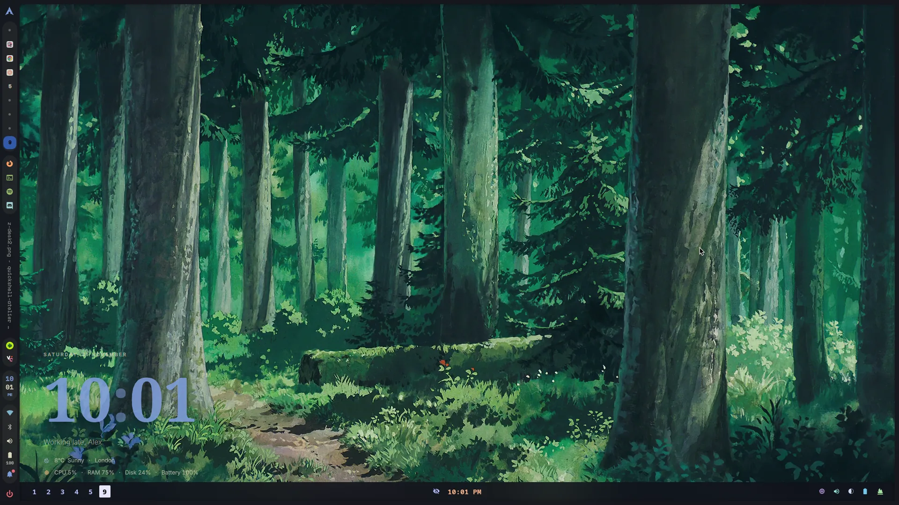

## Screenshots

Every panel is a drawer that grows out of the frame. Shown in the Kanagawa theme.

<table>
<tr>
<td width="50%">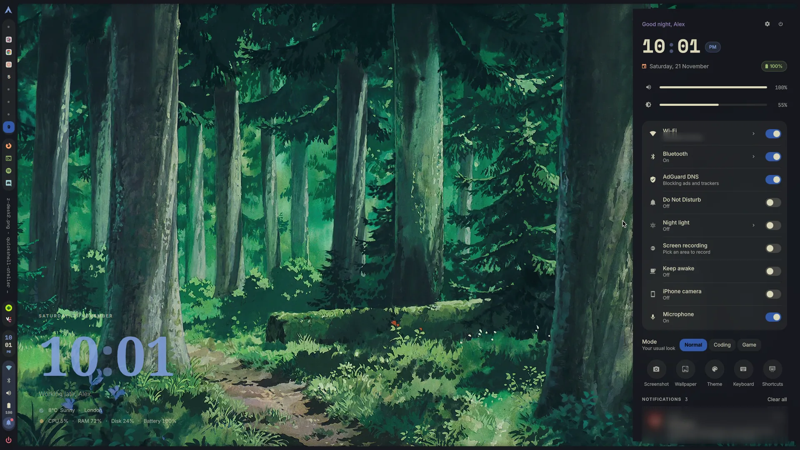<br><b>Control center</b>: toggles, sliders, modes, notifications · <code>Super + C</code></td>
<td width="50%">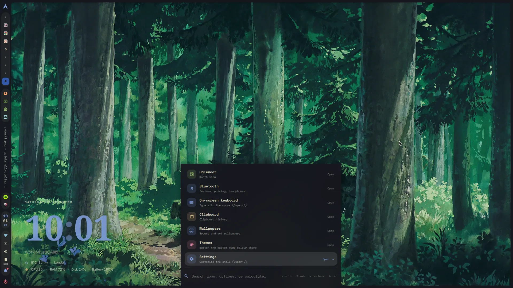<br><b>Launcher</b>: apps, actions, calculator, web search · <code>Super + Space</code></td>
</tr>
<tr>
<td>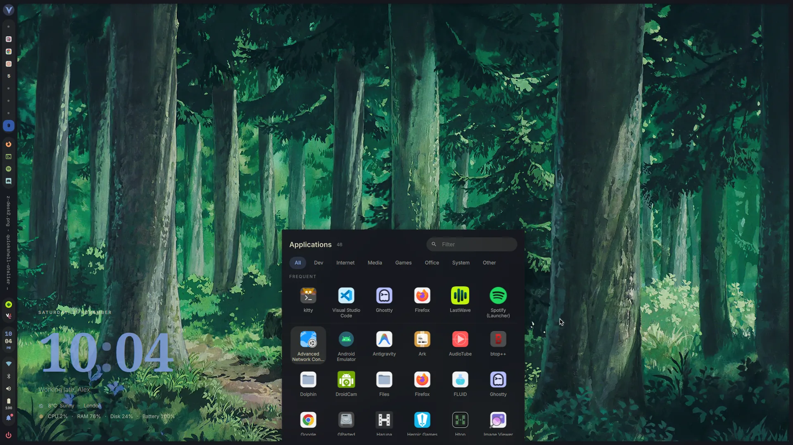<br><b>App grid</b> by category · bar logo / <code>Super + D</code></td>
<td>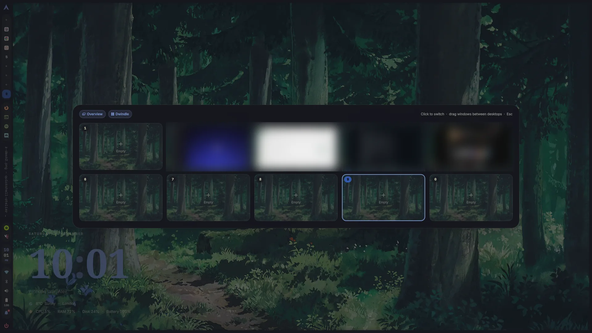<br><b>Overview</b>: workspaces with live window thumbnails, drag to move · <code>Super + Tab</code></td>
</tr>
<tr>
<td>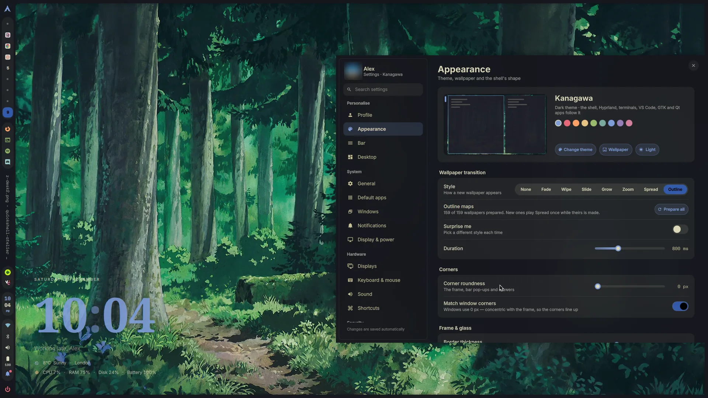<br><b>Settings</b>: a drawer from the right edge, edits everything live · <code>Super + ,</code></td>
<td>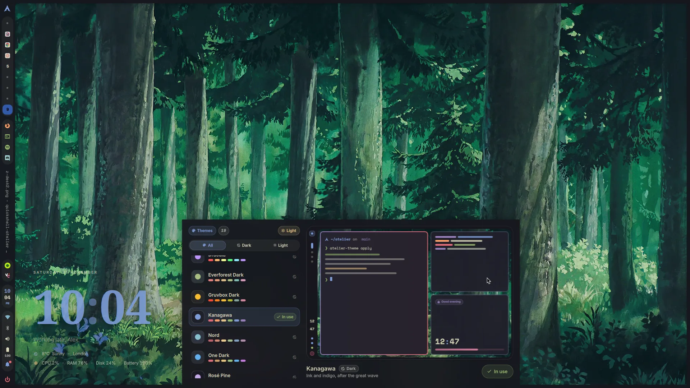<br><b>Themes</b>: one click recolours the shell, Hyprland, terminals, GTK, Qt, VS Code, Neovim</td>
</tr>
<tr>
<td>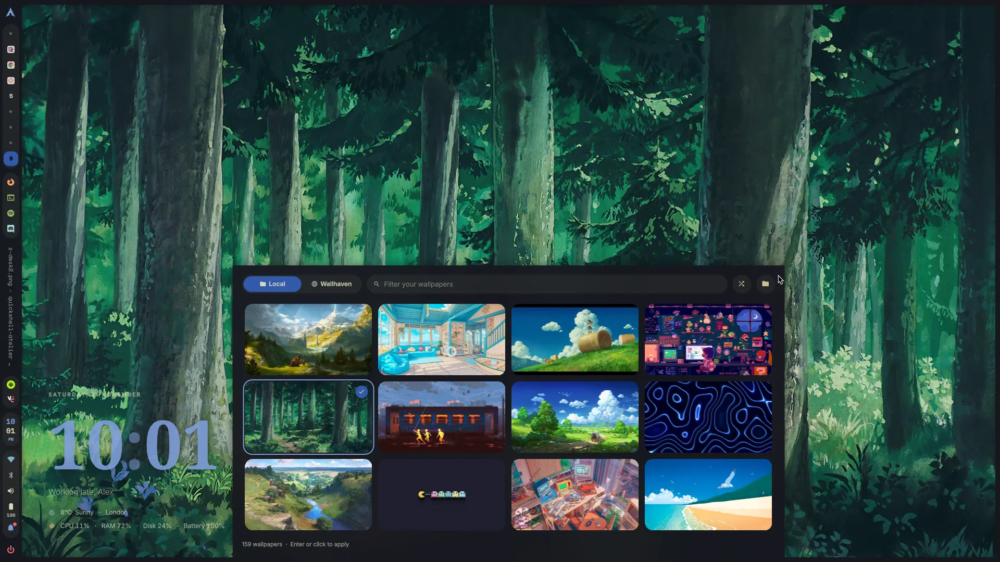<br><b>Wallpapers</b>: local folder + Wallhaven (safe search)</td>
<td>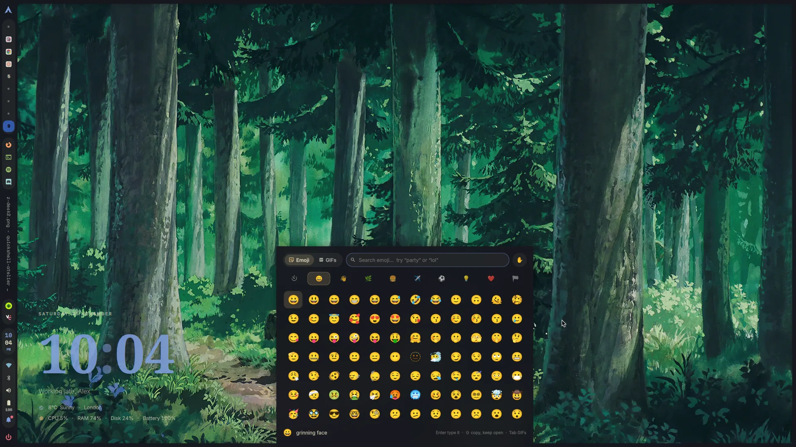<br><b>Emoji picker</b> (and a GIF tab) · <code>Super + ;</code> / <code>Super + Shift + ;</code></td>
</tr>
<tr>
<td>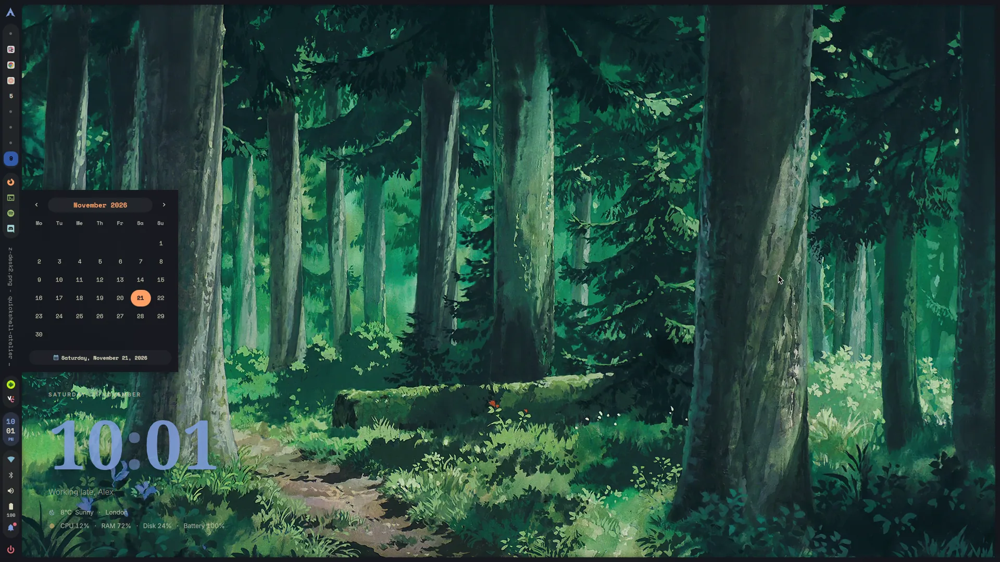<br><b>Calendar</b> from the bar clock</td>
<td>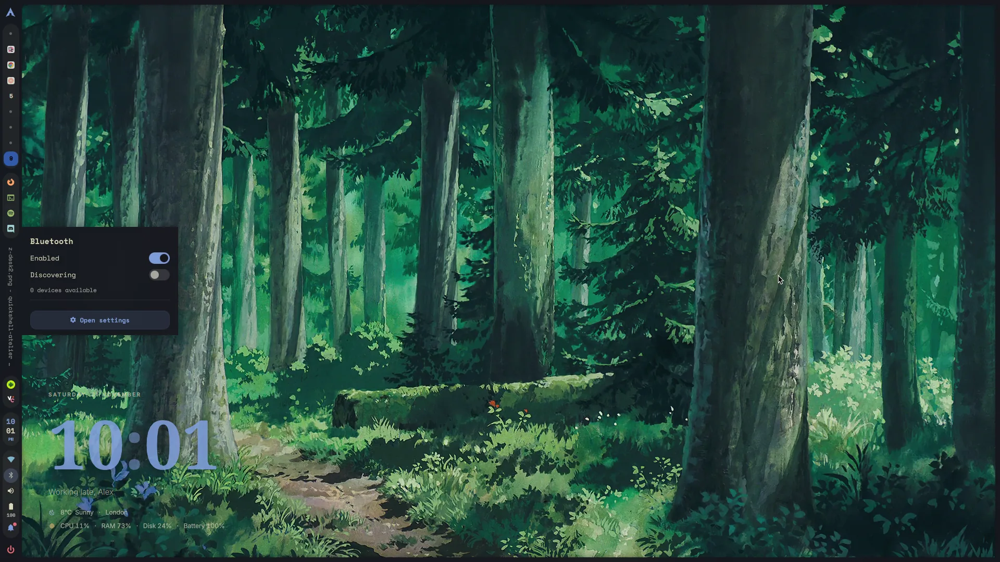<br><b>Bluetooth</b> from the bar (Wi-Fi works the same way)</td>
</tr>
<tr>
<td>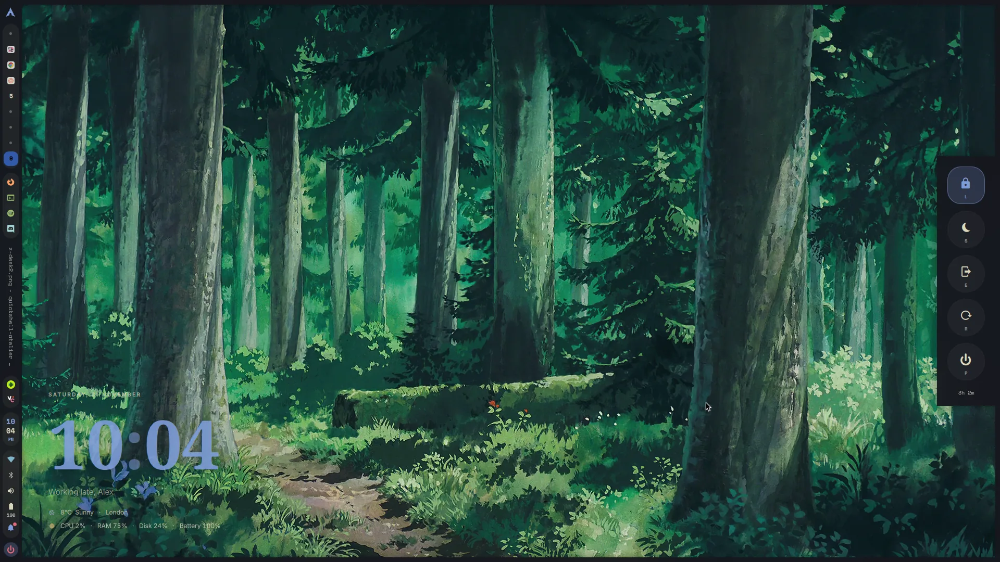<br><b>Session menu</b>: lock, sleep, log out, restart, power off · <code>Super + Backspace</code></td>
<td>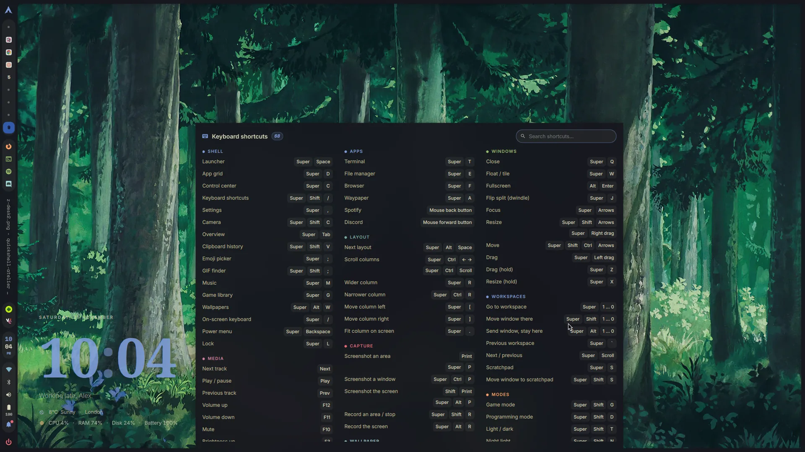<br><b>Keyboard shortcuts</b> cheat sheet, searchable · <code>Super + Shift + /</code></td>
</tr>
</table>

## Install (one command)

```bash
git clone https://github.com/<your-user>/quickshell-atelier.git ~/quickshell-atelier && ~/quickshell-atelier/install.sh
```

**This folder is the source of truth.** Copy it (or clone it) to a new Arch machine, run
`./install.sh`, reboot, and the machine matches this one: packages, drivers, system files,
every config, themes, the login screen. Keep the folder where it is afterwards: your configs are
**symlinks** into it, so editing either side edits the same file. When copying by hand, include
`hypr/wall/` (the wallpapers; too big for git).

Dotfiles only (no `sudo`, no packages, no `/etc` changes):

```bash
~/quickshell-atelier/install.sh --dotfiles-only
```

Preview without changing anything: `./install.sh --dry-run`. Skip the login screen: `--no-greeter`.

### What the installer does
1. Enables `[multilib]`, installs `yay` if needed, then `setup/packages/pacman.txt` + `aur.txt`,
   headers for every installed kernel (DKMS), and GPU drivers by detected hardware
   (`setup/packages/gpu-nvidia.txt`, `gpu-amd.txt`, `gpu-intel.txt`).
2. Copies `system/etc/*` into `/etc` (iPhone-webcam `v4l2loopback` devices, `ntsync`, zram) and,
   with an NVIDIA GPU, `system/nvidia/etc/*` (DRM modeset + early KMS; rebuilds the initramfs).
   Replaced files are backed up to `~/.config/atelier-backups/system_<timestamp>/`.
3. Enables NetworkManager, bluetooth, power-profiles-daemon, sshd, timesyncd and ufw (deny incoming).
4. Installs the Colloid icons and unpacks the bundled GTK themes (`setup/gtk-themes.tar.xz` → `~/.themes`).
5. Backs up anything it would replace to `~/.config/atelier-backups/backup_<timestamp>/` (nothing is
   deleted), then symlinks the repo into place (safe to re-run).
6. Seeds files that apps rewrite themselves, once: `setup/seed/config/*` → `~/.config/*`
   (Atelier state, VS Code settings, Vesktop app settings, default apps, user dirs, Dolphin, Spicetify themes/apps).
   Installs launchers from `local/share/applications/`.
7. Builds the qt6ct plugin (`theming/build-qt6ct.sh`), installs `setup/vscode-extensions.txt`, and applies
   the current Atelier theme so every app follows it.
8. Sets zsh as the default shell and installs the login screen (`greeter/install.sh --enable`).

Not covered (do these by hand): the Android SDK/emulator images, the LastWave AppImage
(`~/Applications/LastWave`), browser profiles and app logins.

## How the repo is laid out

Each folder mirrors where its files end up, so you can tell from the path what a file is for.

```
quickshell/    the shell: bar, drawers, lock screen, settings app        → ~/.config/quickshell
hypr/          Hyprland (Lua config)                                      → ~/.config/hypr
greeter/       the login screen (greetd) and its installer, install.sh
theming/       atelier-theme, the theme engine, and its palettes          → ~/.local/bin/atelier-theme
config/        app configs, one folder per app                            → ~/.config/<name>
local/         bin/ and share/ (launchers, Dolphin menu)                  → ~/.local/<path>
system/        etc/ (→ /etc), nvidia/, boot/grub, boot/refind             installed with sudo
setup/         what the installer reads: packages/, seed/ (copied once),
               the GTK themes tarball, VS Code extensions
docs/          screenshots and the preview page
install.sh     sets all of it up
```

## What gets linked

| Repo | Target |
|---|---|
| `quickshell/` | `~/.config/quickshell` |
| `hypr/` | `~/.config/hypr` |
| `config/<name>` (kitty, ghostty, nvim, zed, zellij, fastfetch, qt5ct, qt6ct, Kvantum, gtk-3.0, gtk-4.0, btop, cava, swappy, zathura, environment.d, zsh, scripts, starship.toml) | `~/.config/<name>` |
| `config/vesktop/settings/` | `~/.config/vesktop/settings` (Vencord plugins, quick CSS) |
| `config/zsh/.zshrc` | `~/.zshrc` |
| `theming/atelier-theme`, `local/bin/prime-run`, `local/bin/audiotube`, `config/scripts/adguard-dns.sh` | `~/.local/bin/<name>` |
| `local/share/kio/servicemenus/atelier-airdrop.desktop` | Dolphin's "Send with AirDrop" menu |

## Login screen (Quickshell instead of SDDM)

The `greeter/` folder is a Quickshell login screen built on **greetd**. It looks exactly like
your lock screen: it loads the same style files (Atelier or a phone style, whichever
Settings → Lock screen uses, with the same options), on your wallpaper and in your theme. A small
pill in the top-left corner picks the person (F1) and the desktop session (F2).

```bash
greeter/install.sh --demo              # preview it fullscreen (password: demo, Esc closes), changes nothing
sudo greeter/install.sh               # install greetd + cage + greeter files (login manager unchanged)
sudo greeter/install.sh --enable      # switch the login manager from SDDM to greetd
sudo greeter/install.sh --refresh     # update the installed greeter after pulling changes
sudo greeter/install.sh --quiet-boot  # hide kernel/systemd text at boot (edits /etc/kernel/cmdline)
sudo greeter/install.sh --uninstall   # switch back to SDDM and remove the greeter
```

**Settings → Login screen** controls it after installing: *Follow your look* copies your colours,
wallpaper, lock style and `~/.face` over whenever they change. It also has Preview, Install/Update
and Quiet boot buttons. This works without root because the installer gives you
`/var/lib/atelier-greeter`, where the greeter reads its options and pictures.

Whatever the session prints at startup goes to `~/.local/state/atelier-session.log` instead of
the screen.

If a login ever fails: `Ctrl+Alt+F3`, log in, then
`sudo systemctl disable greetd && sudo systemctl enable --force sddm && sudo reboot`.

## Performance modes (Game / Programming / Battery saver / Showcase)

The UI keeps the same look; the work behind it changes. Switch in the control center, in
*Settings → Behavior → Performance modes*, with keys, or over IPC.

| Mode | Key | What it does |
|---|---|---|
| **Normal** | | Your own look and settings. Windows glide in on a soft spring; drawers open with one gentle overshoot. |
| **Programming** | `Super+Shift+D` | Opaque windows (crisp text, no blur work behind them), 1-pass blur, crisp low-travel animations (shorter, barely any scale or slide, no overshoot, in windows and the shell alike), no dimming, performance power profile (balanced on battery), screen kept awake. Remembered across logins. |
| **Battery saver** | `Super+Shift+B` | The least the screen has to draw: opaque windows (nothing is blended), no blur, shadows, animations or dimming, the power-saver profile, desktop widget not drawn, no shell shadows or glass, shell animations 1.9× faster. Every part can be changed in Settings → Modes. Remembered across logins. |
| **Showcase** | `Super+Shift+A` | The opposite of the others: everything on, looks first. Full blur (3+ passes), shadows, glass, and the [hyprimate](https://github.com/JustinBacher/hyprimate) plugin's shader animations (liquid, cloth, paper, swarm, bubble… windows, optional cube / lava workspace transitions). Build the plugin once with `setup/hyprimate.sh`; it is loaded only in this mode and unloaded when you leave. Per session, not kept across logins. |
| **Game** | `Super+Shift+G` | No blur / shadows / animations (or, if you keep them, fades only: nothing moves over the game), quick shell drawers, opaque windows and shell glass, tearing allowed, performance power profile, Do Not Disturb, screen kept awake, desktop widgets not drawn. Not remembered across logins. |

**Game library** (`Super+G`): a drawer from the bottom edge, styled like the rest of the shell, listing every installed game:
Steam (all libraries, including `/mnt/games`), Heroic (Epic, GOG, sideloaded), Lutris, `.desktop`
games and an optional hand-written `~/.config/atelier/games.json`
(`[{"title": "…", "command": "…", "cover": "/path.jpg"}]`). Cover art is downloaded once into
`~/.cache/atelier/game-art`. Arrow keys or a click to choose, Enter to play, type to search, Tab to switch source.

*Game mode automatically* (Settings → Behavior, on by default): focusing a game (Steam, gamescope,
Lutris, Heroic, ...) switches to Game mode, and closing it switches back. Leaving any mode restores
your power profile, Do Not Disturb and caffeine exactly as they were.

```bash
qs ipc call mode set game|dev|saver|showcase|normal      # also: cycle, toggleGame, toggleDev, toggleSaver, toggleShowcase, get
```

## Daily use

| Action | How |
|---|---|
| Launcher | `SUPER + Space` |
| App grid (also the bar logo) | `SUPER + D` |
| Wallpaper: next / previous / random | `SUPER + ALT + →` / `←` / `I` |
| Control center | `SUPER + C` |
| Keyboard shortcuts (all keys, searchable; also Control center → Shortcuts) | `SUPER + Shift + /` |
| Scrolling layout: scroll / column width / move column / fit | `SUPER + Ctrl + ←→` · `SUPER + R` · `SUPER + [ ]` · `SUPER + .` |
| Settings app | `SUPER + ,` |
| Terminal / file manager (whatever Settings → Default apps picked) | `SUPER + T` / `SUPER + E` |
| Default apps: browser, files, editor, pictures, video, music, PDF, archives, terminal | Settings → Default apps (writes `~/.config/mimeapps.list`; `quickshell/scripts/default-apps.py list\|set`) |
| Power menu | `SUPER + Backspace` |
| Clipboard history | `SUPER + Shift + V` |
| Emoji picker | `SUPER + ;` |
| GIF finder (free GIPHY/Tenor key in Settings → Tools) | `SUPER + Shift + ;` |
| On-screen keyboard | `SUPER + /` |
| Game library | `SUPER + G` |
| Record screen (pick an area / stop) | `SUPER + Shift + R` (whole screen: `SUPER + Alt + R`, or `R` in the screenshot picker) |
| Night light | `SUPER + Shift + N` (schedule and warmth in Settings → Appearance) |
| Music drawer | hover the middle of the top screen edge, or `SUPER + M` |
| System monitor (CPU, memory, GPU, network, apps with kill, battery health and charge limit) | `SUPER + Shift + M` |
| Timers, stopwatch and pomodoro | `SUPER + Alt + T` (`qs ipc call timers start "10m tea"`) |
| Colour picker (click any pixel, copies the hex; history drawer: `qs ipc call colorpicker toggle`) | `SUPER + Shift + X` |
| Alt-Tab window switcher | hold `ALT`, tap `Tab` (`Shift + Tab` goes back); release `ALT` to switch |
| Reload shell | `qs kill; quickshell -d` |
| Reload Hyprland | automatic on save (avoid `hyprctl reload`: it makes the cursor hitch) |
| List / apply theme | `atelier-theme list` / `atelier-theme apply tokyo-night` |
| Light/dark toggle | `atelier-theme toggle-mode` |

Themes (29): Catppuccin (Mocha, Macchiato, Frappé, Latte), Dracula, Everforest (dark, light), Flexoki (dark, light), GitHub (dark, light), Gruvbox (dark, light), Kanagawa (Wave, Dragon, Lotus), Nord, One (Dark, Light), Ayu (Mirage, Light), Rosé Pine (+ Moon, Dawn), Solarized (dark, light), Tokyo Night (+ Storm, Day).
Add your own as JSON in `theming/themes/` or `~/.config/atelier/themes/`.

## Hardware settings and profiles

The Settings app (`SUPER + ,`, a drawer from the right edge) configures the machine, not just the shell. Everything applies
live and is also written to `hypr/atelier-settings.lua`, so it holds at the next login.

| Page | What it does |
|---|---|
| **Displays** | Resolution, refresh rate, scale, rotation, position, mirroring and VRR for each connector. Every change asks *Keep these settings?* and reverts by itself after 15 s. |
| **Keyboard & mouse** | Layouts and how to switch between them, Caps Lock remap, key repeat, pointer speed and acceleration, natural scrolling, touchpad tap/click/drag options, focus follows mouse. |
| **Sound** | Default output and microphone, their volume and mute, and the volume of each app that is playing or recording. |
| **Shortcuts** | Record new keys for any built-in shortcut or turn it off (conflicts are flagged), and add your own key → command shortcuts. |
| **Profiles** | Save all settings plus the theme and wallpaper under a name, switch between profiles, export or import one as a file, and switch automatically when a display is plugged in (e.g. *Docked* when `HDMI-A-1` connects). |

From scripts: `qs ipc call profiles list|save <name>|apply <name>|active`, and
`qs ipc call settings open displays|input|sound|shortcuts|profiles`.

## Plugins

Add your own lock styles, desktop widgets, bar items, launcher actions, control-centre tiles and Settings pages without
touching the shell. Settings → **Plugins** installs one from a git URL, a `.zip` or a folder (it stays off until you
read and approve it), switches it on or off, or removes it. Or drop a folder into `~/.config/atelier/plugins/` and press
Reload. A plugin is a `plugin.json` plus QML files that follow the theme; `examples/plugins/hello/` has one of each, and
[docs/plugins.md](docs/plugins.md) is the guide. From scripts: `qs ipc call plugins list|reload|enable|disable|install|remove`.
Plugins are code that runs inside your shell: only install ones you trust.

## Notes
- **Icons:** [Colloid](https://github.com/vinceliuice/Colloid-icon-theme) everywhere (GTK, Qt/qt6ct, KDE, the shell). `install.sh` fetches the variants your themes use, and `atelier-theme apply <id>` switches to the matching one (e.g. Catppuccin → `Colloid-Purple-Catppuccin-Dark`).
- **Wallpapers** live in `hypr/wall/` and are git-ignored (large). Drop your own images there.
- Machine-specific state (`~/.config/atelier/state.json`, etc.) is seeded from `setup/seed/config/atelier/` but never overwritten.
- `~/.local/bin` must be on your `PATH` for `atelier-theme`.
- Qt theming plugin: run `theming/build-qt6ct.sh` once if you want themed Qt apps.
